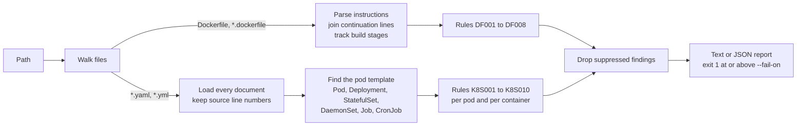

# infra-policy-linter

A linter for the two files that decide how a service runs in production: its Dockerfile and its Kubernetes manifest. It reports risky settings with the file, line and reason, and exits non-zero so a pull request cannot merge them.

18 rules. One dependency (PyYAML). Python 3.10+.

## How it works



## Rules

| Rule | Severity | Problem | Why it matters |
|---|---|---|---|
| `DF001` | medium | Base image has no fixed tag | `latest` changes under you: two builds of one commit can ship different code |
| `DF002` | high | Container runs as root | A process that escapes the app is root inside the container, and often on the host |
| `DF003` | medium | ADD fetches a remote URL | The download is unverified and uncached; use COPY, or RUN curl with a checksum |
| `DF004` | high | Secret baked into the image | ENV and ARG values are stored in image layers and readable by anyone who pulls it |
| `DF005` | high | Remote script piped straight into a shell | Whatever the server returns at build time runs as root, unreviewed |
| `DF006` | low | pip install without --no-cache-dir | The download cache stays in the layer and enlarges the image |
| `DF007` | low | No HEALTHCHECK | The runtime cannot tell a hung process from a healthy one |
| `DF008` | medium | apt-get install without --no-install-recommends | Pulls in optional packages, growing the image and its attack surface |
| `K8S001` | high | Privileged container | Privileged mode disables almost all isolation from the host |
| `K8S002` | high | Privilege escalation not disabled | Without allowPrivilegeEscalation: false, a setuid binary can gain more rights than the process started with |
| `K8S003` | high | May run as root | Neither the pod nor the container sets runAsNonRoot: true |
| `K8S004` | medium | No CPU or memory limit | One leaking container can starve every other pod on the node |
| `K8S005` | medium | Image has no fixed tag | A restart may silently pull a different version |
| `K8S006` | high | Shares a host namespace | hostNetwork, hostPID or hostIPC lets the pod see or reach host processes and traffic |
| `K8S007` | high | Mounts a host path | hostPath volumes expose the node's filesystem to the pod |
| `K8S008` | low | No liveness or readiness probe | Traffic is sent to pods that are not ready, and hung pods are never restarted |
| `K8S009` | high | Secret written as a literal env value | It is visible in the manifest and in `kubectl describe`; use secretKeyRef |
| `K8S010` | medium | Capabilities not dropped | Containers keep default Linux capabilities they almost never need; drop ALL and add back specifics |

## Output

`python -m policylint examples/bad` on the two deliberately bad files in this repository. Actual output:

```
MEDIUM DF001   Dockerfile:1               Base image has no fixed tag
               FROM python. `latest` changes under you: two builds of one commit can ship different code.
HIGH   DF002   Dockerfile:1               Container runs as root
               final stage never sets USER. A process that escapes the app is root inside the container, and often on the host.
LOW    DF007   Dockerfile:1               No HEALTHCHECK
               final stage has no HEALTHCHECK. The runtime cannot tell a hung process from a healthy one.
HIGH   DF004   Dockerfile:2               Secret baked into the image
               ENV API_TOKEN=<redacted>. ENV and ARG values are stored in image layers and readable by anyone who pulls it.
MEDIUM DF003   Dockerfile:3               ADD fetches a remote URL
               ADD https://example.com/tool.tar.gz. The download is unverified and uncached; use COPY, or RUN curl with a checksum.
MEDIUM DF008   Dockerfile:4               apt-get install without --no-install-recommends
               apt-get install. Pulls in optional packages, growing the image and its attack surface.
HIGH   DF005   Dockerfile:5               Remote script piped straight into a shell
               download piped to a shell. Whatever the server returns at build time runs as root, unreviewed.
LOW    DF006   Dockerfile:7               pip install without --no-cache-dir
               pip install. The download cache stays in the layer and enlarges the image.
HIGH   K8S006  deployment.yaml:13         Shares a host namespace  [Deployment/payments]
               hostNetwork. hostNetwork, hostPID or hostIPC lets the pod see or reach host processes and traffic.
HIGH   K8S001  deployment.yaml:15         Privileged container  [Deployment/payments container=api]
               securityContext.privileged: true. Privileged mode disables almost all isolation from the host.
HIGH   K8S002  deployment.yaml:15         Privilege escalation not disabled  [Deployment/payments container=api]
               allowPrivilegeEscalation is not false. Without allowPrivilegeEscalation: false, a setuid binary can gain more rights than the process started with.
HIGH   K8S003  deployment.yaml:15         May run as root  [Deployment/payments container=api]
               runAsNonRoot is not true. Neither the pod nor the container sets runAsNonRoot: true.
MEDIUM K8S004  deployment.yaml:15         No CPU or memory limit  [Deployment/payments container=api]
               no limit for cpu or memory. One leaking container can starve every other pod on the node.
MEDIUM K8S005  deployment.yaml:15         Image has no fixed tag  [Deployment/payments container=api]
               image: registry.example.com/payments:latest. A restart may silently pull a different version.
LOW    K8S008  deployment.yaml:15         No liveness or readiness probe  [Deployment/payments container=api]
               no probes. Traffic is sent to pods that are not ready, and hung pods are never restarted.
MEDIUM K8S010  deployment.yaml:15         Capabilities not dropped  [Deployment/payments container=api]
               capabilities.drop does not include ALL. Containers keep default Linux capabilities they almost never need; drop ALL and add back specifics.
HIGH   K8S009  deployment.yaml:20         Secret written as a literal env value  [Deployment/payments container=api]
               env DB_PASSWORD=<redacted>. It is visible in the manifest and in `kubectl describe`; use secretKeyRef.
HIGH   K8S007  deployment.yaml:25         Mounts a host path  [Deployment/payments]
               volume docker -> /var/run/docker.sock. hostPath volumes expose the node's filesystem to the pod.
2 file(s) checked: 9 high, 6 medium, 3 low; 15 at or above 'medium'
```

`python -m policylint examples/good` on the corrected versions of the same files:

```
2 file(s) checked: 0 high, 0 medium, 0 low
```

## What the tests check

| Behaviour | Test |
|---|---|
| Each of the 18 rules fires on its own problem and on nothing else: one change to a clean file yields exactly one rule | `test_each_rule_fires_on_exactly_its_own_problem` (both files); the Kubernetes test also asserts every rule has a case |
| Safe look-alikes pass: local `ADD`, `*_FILE` paths, `$VAR` references, `secretKeyRef`, `TOKEN_TTL=3600`, digests, registry ports | `test_safe_variants_are_not_flagged`, `test_image_tag_detection` |
| Multi-stage builds: root in a build stage is fine, only the final stage must drop it; `FROM build` is a stage, not an untagged image | `test_multistage_only_the_final_stage_must_drop_root` |
| A container-level security setting overrides the pod-level one | `test_container_setting_overrides_pod_setting` |
| Init containers are checked, but not for probes | `test_init_containers_are_checked_but_do_not_need_probes` |
| Findings point at the correct source line and name the container | `test_findings_point_at_the_right_line_and_container`, `test_continuation_lines_join_and_report_the_first_line` |
| Suppressions cover one rule on one instruction or one resource, not more | `test_ignore_comment_suppresses_one_rule_on_one_instruction`, `test_annotation_suppresses_listed_rules_for_that_resource_only` |
| Secret values never appear in the report | `test_secret_value_is_never_echoed` |
| Exit codes follow `--fail-on`; files that are not valid YAML are listed as skipped, not crashed on | `test_fail_on_threshold_and_unparseable_files`, `test_example_directories_and_exit_codes` |

18 tests. CI runs them on Python 3.10 and 3.12, then lints `examples/good`.

## Use

```bash
pip install -e ".[dev]"
python -m policylint .                      # fails on medium and high
python -m policylint deploy/ --fail-on high
python -m policylint . --json > report.json
```

Suppress a reviewed exception where it applies, with the reason next to it:

```dockerfile
# A command-line tool that exits when done: there is no server to health-check.
# policylint:ignore=DF007
FROM python:3.12-slim
```

```yaml
metadata:
  annotations:
    policylint/ignore: "K8S008"
```

This repository's own `Dockerfile` uses the first form and passes at `--fail-on low`.

## Layout

| File | Contents |
|---|---|
| `policylint/core.py` | Rule catalogue, `Finding`, image-tag and secret-name checks |
| `policylint/dockerfile.py` | Instruction parser and Dockerfile rules |
| `policylint/k8s.py` | Line-tracking YAML loader and manifest rules |
| `policylint/scan.py` | File discovery |
| `examples/` | A bad and a good version of the same Dockerfile and Deployment |

## Limits

- It reads files; it does not talk to a cluster or inspect built images. A setting changed with `kubectl edit` or injected by an admission controller is invisible to it.
- Helm and Kustomize templates must be rendered first (`helm template ... | ...` to a file). Unrendered templates are reported as skipped.
- The rules are a focused subset of what tools such as Hadolint, Trivy, kube-score and OPA Gatekeeper cover. There is no custom-rule language.
- `K8S003` cannot see a `USER` set inside the image, so an image that already runs as non-root is still flagged until the manifest says so.
- The secret rules match on variable names, so a secret in an unhelpfully named variable is missed.
- Shell parsing in `RUN` is by regular expression, not a real shell parser; unusual quoting can hide a `curl | sh`.
